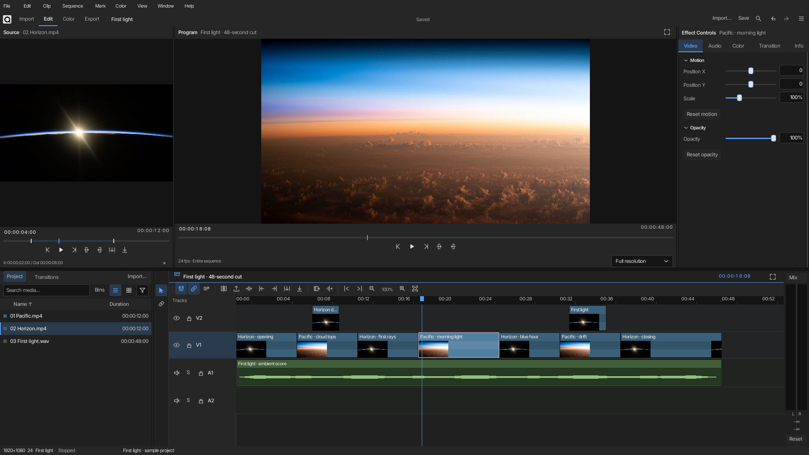
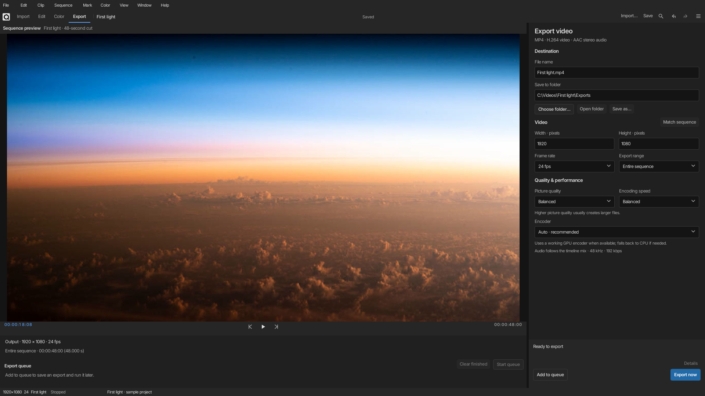

<p align="center">
  
</p>

# Quaternio

A free, open-source video editor written in Rust. Beta builds available for Windows, Linux, and macOS.

**[Download Quaternio](https://github.com/truefish/Quaternio/releases)**

## Screenshots

Sample project shown.

**Edit:** browse media, arrange clips, and adjust the picture.



**Export:** choose the file name, output folder, quality, and encoding method.



Sample imagery: [NASA](https://www.nasa.gov/image-article/sunrise-over-pacific-2/) and [NASA/Matthew Dominick](https://www.nasa.gov/image-article/sunrise-begins/).

## Versions and project files

App version (the release you download, e.g. `0.1.0-beta.1`) is independent of the `.quaternio` project schema (`PROJECT_VERSION` in the file). Updating Quaternio does not require re-saving projects unless a release notes a schema change. Older projects keep loading; projects saved with a newer schema need a matching or newer editor.

In Preferences → **Versions**, you can browse published GitHub releases and install or switch builds. When a newer release exists, a quiet toolbar badge appears — no modal on launch.

## Review and background activity

Open **Review** in the toolbar to add timecoded notes at the playhead, jump between notes, search reviewers, and resolve or reopen feedback. Notes save with the project and support undo. Save the project before exporting a `.qreview` file; reviewers should start from that same saved project. Import adds new notes without replacing local resolution of existing notes. Review files contain notes and project identity, not footage or local media paths. Older projects receive an identity on load, so save once before distributing review copies.

Choose **Track height** beside the timeline zoom controls, or search the command palette for Compact, Medium or Large tracks. This preference stays local and does not change the project.

Open **Activity** to see imports, export progress, preview preparation and media-engine setup while editing.

## Live peer editing

Open **Collaborate** in the toolbar. A participant hosts the project; no account or hosted signaling service is required.

1. Choose **Start a session**, enter the other person’s name, select **Can edit** or **Can view only**, then choose **Create invitation**.
2. Choose **Save invitation…** and send the `.qpeer` file privately. Each person needs a separate invitation.
3. The other person chooses **Join from invitation…**, opens the file, then uses **Save reply…** to send a reply back.
4. Choose **Open their reply…** to finish connecting. Edits then synchronize over an encrypted WebRTC connection. **Use a code instead** provides the same flow by pasting codes.

Moves, trims, splits, inserts, deletes, ripple edits, track changes, transitions, review notes and clip properties synchronize through the host's ordered log. Independent properties merge. Ambiguous structural edits are rejected atomically and retained for review; use **Save retained local branch** to preserve the local version. Undo/redo compensate the author's changes and refuse to overwrite later conflicting work.

Playhead, selection, workspace, source marks and media paths remain local. Footage is not transferred: use local relinking on each machine. Exports wait for acknowledged edits and use an immutable local project snapshot. The host can revoke invitations; the server enforces Viewer permissions.

Direct LAN connections work without public services. Internet connections across NAT may require your own STUN/TURN configuration on both endpoints. Set `QUATERNIO_ICE_SERVERS` before launching to a JSON array, for example `[{"urls":["stun:stun.example.net:3478"],"username":"","credential":""}]`. TURN entries also require their username and credential. No public STUN/TURN service is enabled by default. Cross-network relay operation still needs deployment validation.

If a connection is lost, the current local document remains available. Use a fresh invitation to reconnect; automatic reconnect and host handoff are pending. Host logs (`.qsession`) and client outboxes (`.qoutbox`) are stored under Quaternio's app-data `sessions` directory. The collaboration panel can recover acknowledged host history or a retained client branch as a local project. Save that recovered copy before starting another session.

## Quickstart

Download a build from [Releases](../../releases). Application archives do not bundle FFmpeg. Quaternio detects a compatible existing `ffmpeg`/`ffprobe` pair. If none is found, import/export offers one-time setup or selection of installed tools. The managed engine is stored in user app-data and reused across releases; editing works offline after setup.

### Windows (x64)

**Installer**

1. Download `Quaternio-Setup-v….exe` (example: `Quaternio-Setup-v0.1.0-beta.1.exe`).
2. Run the installer.
3. Open **Quaternio** from the Start menu.

Quaternio installs under `%LOCALAPPDATA%\Quaternio` (no admin required). Windows may show a SmartScreen warning on this unsigned beta — choose **More info** → **Run anyway**.

**Portable zip**

1. Download `Quaternio-Windows-Portable-v….zip`.
2. Extract the zip to a folder.
3. Open that folder and double-click `quaternio.exe`.

Keep `quaternio.exe` in your application folder. Open **Media engine** in Preferences or the command palette to install or select media tools. Legacy tools beside the app remain discoverable.

### Linux (x86_64)

Release builds are **x86_64 only** (not ARM). You need a desktop session (X11 or Wayland).

1. Download `Quaternio-Linux-x86_64-v….tar.gz`.
2. Extract and enter the folder:

```bash
tar -xzf Quaternio-Linux-x86_64-v0.1.0-beta.1.tar.gz
cd Quaternio-Linux-x86_64-v0.1.0-beta.1
```

(Use the exact file and folder names from the release.)

3. Run:

```bash
./quaternio
```

Linux uses OpenGL (FemtoVG) and selects X11/XWayland when `DISPLAY` is available. This enables file-manager drag-and-drop with the bundled window backend. Native Wayland remains available; use **File → Import media** there because this backend does not receive native Wayland file drops.

```bash
WINIT_UNIX_BACKEND=x11 ./quaternio
# To choose native Wayland:
WINIT_UNIX_BACKEND=wayland ./quaternio
```

If OpenGL is unavailable, use software rendering on X11/XWayland:

```bash
WINIT_UNIX_BACKEND=x11 SLINT_BACKEND=winit-software ./quaternio
```

If the app fails to start because a library is missing, install common desktop libraries (Debian/Ubuntu):

```bash
sudo apt install libxcb-shape0 libxcb-xfixes0 libxkbcommon0 libxkbcommon-x11-0 \
  libfontconfig1 libx11-xcb1 libxcursor1 libwayland-client0 libegl1 libgl1 \
  libasound2t64 || \
sudo apt install libxcb-shape0 libxcb-xfixes0 libxkbcommon0 libxkbcommon-x11-0 \
  libfontconfig1 libx11-xcb1 libxcursor1 libwayland-client0 libegl1 libgl1 \
  libasound2
```

### macOS

Choose `Quaternio-macOS-arm64-v….tar.gz` for Apple Silicon or `Quaternio-macOS-x86_64-v….tar.gz` for Intel. Older releases may only include Apple Silicon builds.

1. Download the archive for your Mac. The commands below use Apple Silicon; use your downloaded filename for Intel.
2. Extract and enter the folder:

```bash
tar -xzf Quaternio-macOS-arm64-v0.1.0-beta.1.tar.gz
cd Quaternio-macOS-arm64-v0.1.0-beta.1
```

(Use the exact names from the release.)

3. Clear Gatekeeper quarantine (needed for this unsigned beta):

```bash
xattr -dr com.apple.quarantine .
```

4. Run:

```bash
./quaternio
```

If macOS still blocks it: System Settings → Privacy & Security → allow Quaternio, or in Finder right-click `quaternio` → **Open**.

## Exports

- In **Export**, use **Auto** for hardware encoding with a CPU fallback. **Hardware** requires a working GPU encoder and reports a failure if none is available. macOS uses VideoToolbox; Linux can use VAAPI or NVIDIA; Windows can use NVIDIA, Intel, or AMD.

GPU export needs a compatible driver and FFmpeg encoder. AMD can be selected explicitly; Windows also offers an optional D3D11 adapter index. Linux Radeon uses VAAPI and can select a render node through `QUATERNIO_VAAPI_DEVICE`. The chosen encoder and picture-processing route are reported separately. Linux VAAPI also needs the host's `libva` libraries, a GPU driver, and access to `/dev/dri/renderD*`. Picture effects may still run on the CPU. Click an export status message to view or copy the full details.

## Build from source

Use this to compile Quaternio yourself.

You need:

- [Rust](https://rustup.rs/) (stable)
- A compatible **FFmpeg** and **ffprobe** pair, detected from existing tools or installed once through Media engine setup when needed

Debug and release builds share the managed media engine. You can also set `QUATERNIO_FFMPEG_DIR` to a folder containing a matching pair, select a tools folder in Media engine setup, or use `PATH`. Setup validates versions and required capabilities. Offline installation accepts the pinned archives listed in `packaging/ffmpeg-lock.json`, using their `file` names in one folder; alternatively select an already extracted pair.

### Windows (x64)

1. Install [Rust](https://rustup.rs/) (default MSVC toolchain).
2. Install [Visual Studio Build Tools](https://visualstudio.microsoft.com/visual-cpp-build-tools/) with the **Desktop development with C++** workload (required by the MSVC linker).
3. Install FFmpeg so `ffmpeg.exe` and `ffprobe.exe` are on your `PATH`, or plan to copy them next to the built exe.
4. In this repo folder:

```bat
cargo build --release
```

5. Run:

```bat
target\release\quaternio.exe
```

If FFmpeg is not on `PATH`, copy `ffmpeg.exe` and `ffprobe.exe` into `target\release\` first.

### Linux (x86_64)

1. Install [Rust](https://rustup.rs/).
2. Install build packages (Debian/Ubuntu):

```bash
sudo apt update
sudo apt install build-essential pkg-config \
  libxcb-shape0-dev libxcb-xfixes0-dev libxkbcommon-dev \
  libfontconfig-dev libx11-xcb-dev libxcursor-dev \
  libxkbcommon-x11-dev libx11-dev libwayland-dev libasound2-dev \
  libegl1-mesa-dev libgl1-mesa-dev
```

3. Install FFmpeg (`ffmpeg` and `ffprobe` on your `PATH`), or plan to copy them next to the binary.
4. In this repo folder:

```bash
cargo build --release
```

5. Run:

```bash
./target/release/quaternio
```

If FFmpeg is not on `PATH`, copy `ffmpeg` and `ffprobe` into `target/release/` first.

### macOS (Apple Silicon or Intel)

1. Install [Rust](https://rustup.rs/).
2. Install Xcode Command Line Tools:

```bash
xcode-select --install
```

3. Install FFmpeg (`ffmpeg` and `ffprobe` on your `PATH`), for example with Homebrew:

```bash
brew install ffmpeg
```

4. In this repo folder:

```bash
cargo build --release
```

5. Run:

```bash
./target/release/quaternio
```

## License

MIT ([LICENSE](LICENSE)). Release builds also include FFmpeg (its own license) and the Inter font ([OFL](ui/fonts/LICENSE.txt)).
